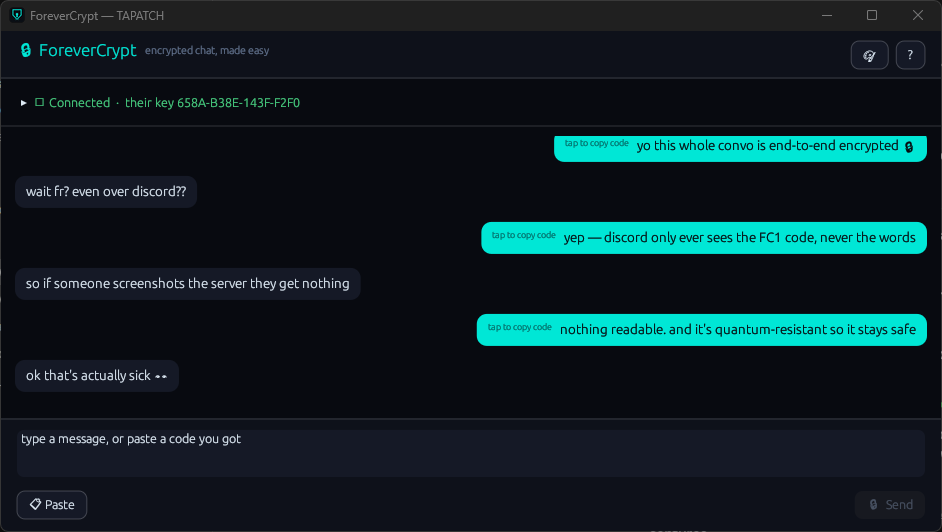
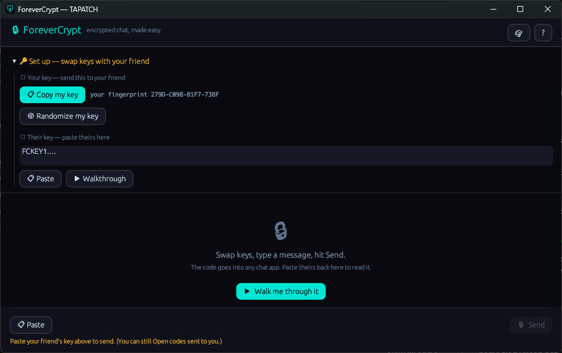
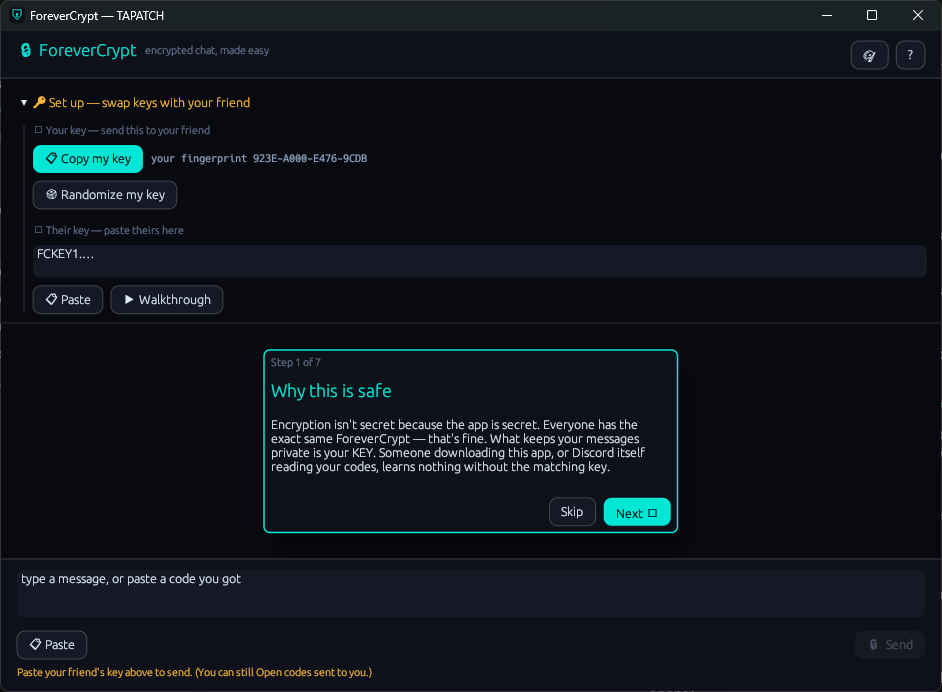
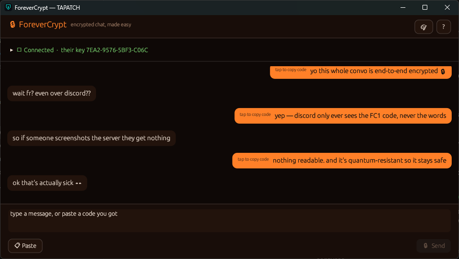

<p align="center"></p>
<h1 align="center">ForeverCrypt</h1>
<p align="center"><b>Quantum-resistant chat, in any app.</b></p>
<p align="center">Encrypted Messaging · Windows 10/11 · x64 · ~2 MB · Free for personal use</p>
<p align="center"><a href="https://github.com/tapatchUSA/ForeverCrypt/releases/latest"><b>⬇ Download ForeverCrypt 1.0.3</b></a> &nbsp;·&nbsp; <a href="https://tapatch.com/tools/forevercrypt/">tapatch.com/tools/forevercrypt</a></p>

<p align="center">
<br>
 <br>

</p>

> Encrypted chat usually means talking someone into installing the same app you have. ForeverCrypt flips that: you keep chatting where you already do — Discord, texts, email — and just paste one short code. The words are never in the clear.

## What it does

ForeverCrypt turns any chat box into an encrypted one. You and a friend swap public keys once, then lock each message to each other and paste the short FC1.… code wherever you already talk. Only the private key on each PC can open a message — not the app, not Discord, not someone who merely downloaded ForeverCrypt. Under the hood it uses ML-KEM-768 (NIST FIPS 203, post-quantum) to exchange a one-time secret to the recipient's key, then seals the text with XChaCha20-Poly1305. Your keypair is generated locally, the private half never leaves your machine, and a built-in Walkthrough explains the whole idea in plain language. 100% offline.

## Features

Real post-quantum cryptography, wrapped in something you can hand to anyone.

**🔑 Swap keys, not secrets**  
You each share a public key (a padlock) once — safe to post anywhere. Messages lock to your friend's padlock and only their private key opens them, so sending a key over Discord gives nothing away.

**💬 Works in any app**  
Type a message, hit Send, and it becomes one short FC1.… code. Paste it into Discord, iMessage, email, a forum — anywhere you already chat. Paste a code back to read it, laid out like a conversation.

**🛡️ Quantum-resistant**  
ML-KEM-768 (NIST FIPS 203) exchanges a one-time secret; XChaCha20-Poly1305 seals the words. Designed to stay unreadable even against a future quantum computer.

**🎲 Your key, always random**  
Each install generates its own keypair from the OS secure RNG, and a Randomize button makes a fresh one anytime. Two copies on one PC get two different identities — never a shared fingerprint.

**🕵️ The app being public is fine**  
Security doesn't depend on the program being secret — everyone has the same ForeverCrypt. The only secret is your private key, and it never leaves your PC.

**🧭 Plain-language walkthrough**  
A built-in 7-step guide explains public vs. private keys, why Discord can't reverse a code, and how to check it's really your friend — no crypto background needed.

**🔒 100% offline**  
No accounts, no servers, no telemetry. ForeverCrypt never connects to anything — it just turns text into codes and back, right on your machine.

## Limitations

- Windows 10/11 only. Security depends on verifying your friend's key fingerprint out of band (e.g. read it aloud on a call) so a pasted key can't be an impostor's. In 1.0 the private key is stored unencrypted in your user profile — a passphrase lock for it is the top item for the next release. ForeverCrypt encrypts the message text; it can't hide from the app you paste codes into who you're talking to.

## What's new in 1.0.3

- Now runs on any Windows 10 or 11 PC, even a fresh install: it no longer needs the Microsoft Visual C++ Redistributable (no more "VCRUNTIME140.dll was not found")
- Nothing else changed

Release notes for every version are on the [Releases](https://github.com/tapatchUSA/ForeverCrypt/releases) page and in [release-notes/](release-notes/).

## Install

1. Download **ForeverCrypt-Setup-1.0.3.exe** from the [latest release](https://github.com/tapatchUSA/ForeverCrypt/releases/latest) or from [tapatch.com](https://tapatch.com/tools/forevercrypt/).
2. Run it. The installer and the app come in 10 languages.
3. Accept the Terms of Service on first launch.

Windows may show a SmartScreen warning for new downloads. Click **More info → Run anyway**.

Or with [Scoop](https://scoop.sh):

```powershell
scoop bucket add tapatch https://github.com/tapatchUSA/packages
scoop install tapatch/forevercrypt
```

## All versions

| Version | Released | Installer | VirusTotal | SHA-256 |
|---|---|---|---|---|
| [1.0.3](https://github.com/tapatchUSA/ForeverCrypt/releases/tag/v1.0.3) | 2026-10-17 | [ForeverCrypt-Setup-1.0.3.exe](https://github.com/tapatchUSA/ForeverCrypt/releases/download/v1.0.3/ForeverCrypt-Setup-1.0.3.exe) | [2 / 71](https://www.virustotal.com/gui/file/9ce6c76f897415de7e36ed8c89782f384a576f08cb97f52da5dc627b906181b2/detection) | `9ce6c76f897415de…` |
| [1.0.2](https://github.com/tapatchUSA/ForeverCrypt/releases/tag/v1.0.2) | 2026-10-01 | [ForeverCrypt-Setup-1.0.2.exe](https://github.com/tapatchUSA/ForeverCrypt/releases/download/v1.0.2/ForeverCrypt-Setup-1.0.2.exe) | [2 / 71](https://www.virustotal.com/gui/file/befb4a81118a9c427a1f02fc95a767db16e1f5b0ce97b683b10c148e7d62ded9/detection) | `befb4a81118a9c42…` |
| [1.0.1](https://github.com/tapatchUSA/ForeverCrypt/releases/tag/v1.0.1) | 2026-09-30 | [ForeverCrypt-Setup-1.0.1.exe](https://github.com/tapatchUSA/ForeverCrypt/releases/download/v1.0.1/ForeverCrypt-Setup-1.0.1.exe) | [3 / 62](https://www.virustotal.com/gui/file/9a0a6a3843391be4e3cdc806f06d77deca885539febf2c62eb7a89eacdff1db0/detection) | `9a0a6a3843391be4…` |
| [1.0.0](https://github.com/tapatchUSA/ForeverCrypt/releases/tag/v1.0.0) | 2026-09-23 | [ForeverCrypt-Setup-1.0.0.exe](https://github.com/tapatchUSA/ForeverCrypt/releases/download/v1.0.0/ForeverCrypt-Setup-1.0.0.exe) | [3 / 71](https://www.virustotal.com/gui/file/71e7c0d5b85ee70d6c517fbbce62d767fe365d3e3a5e875dbb35df8feb620beb/detection) | `71e7c0d5b85ee70d…` |

## Security

Every installer is scanned on VirusTotal before release. ForeverCrypt 1.0.3: **2 / 71** engines flag it · [view report](https://www.virustotal.com/gui/file/9ce6c76f897415de7e36ed8c89782f384a576f08cb97f52da5dc627b906181b2/detection)

**SHA-256**
```
9ce6c76f897415de7e36ed8c89782f384a576f08cb97f52da5dc627b906181b2
```

## Built with

Rust · egui · eframe · ML-KEM-768 · XChaCha20-Poly1305

## License

Free for personal use. Business or commercial use requires a paid license (see [tapatch.com/terms](https://tapatch.com/terms/)). Full terms: [tapatch.com/terms/software](https://tapatch.com/terms/software/).

This repository holds the official installers and release notes.

---

**[tapatch.com](https://tapatch.com)**: small tools, serious quality. Built solo, shipped with care.
