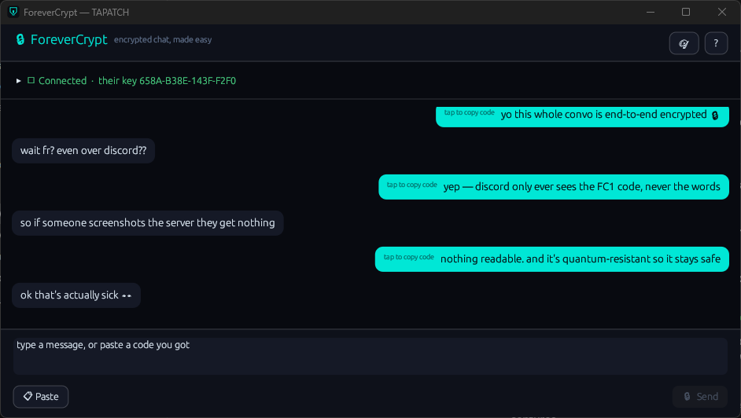
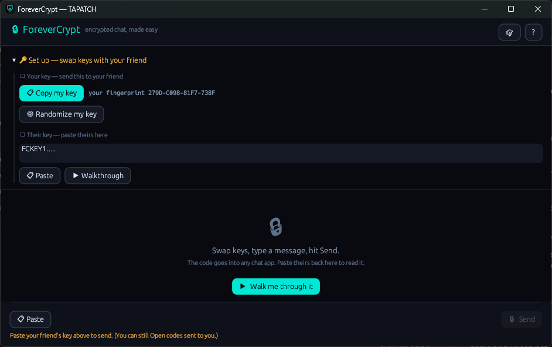
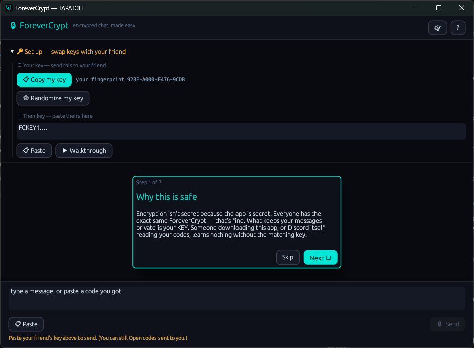
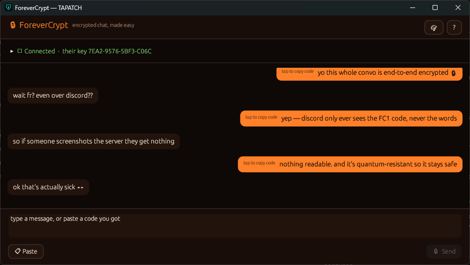

**ForeverCrypt 1.0.4** for Windows 10/11 (x64) · Free for personal use

### What's new

- The 🎨 button opens a Look window: pick a theme, make your own with Custom, and add background pictures or GIFs (tick several and they take turns)
- Sliders set how strong the picture is and how see-through the panels are; turn it off any time
- A key file that can't be read is kept aside (identity.key.unreadable-…) instead of being silently replaced
- The installer's license text matches the current Terms, and THIRD-PARTY-NOTICES.txt lists the open-source parts it uses

### Screenshots

 
  

### Download

**`ForeverCrypt-Setup-1.0.4.exe`** is attached below. It is the same file as on [tapatch.com/tools/forevercrypt](https://tapatch.com/tools/forevercrypt/).

### Security

- VirusTotal: **2 / 70** engines flag it · [view report](https://www.virustotal.com/gui/file/650cd3f99f4ed095c35ec3a72b1cc862953bf535907683e37f79042834079c42/detection)
- SHA-256: `650cd3f99f4ed095c35ec3a72b1cc862953bf535907683e37f79042834079c42`

*First released on tapatch.com on 2026-11-04.*

---
Free for personal use. Business or commercial use requires a paid license (see [tapatch.com/terms](https://tapatch.com/terms/)).
