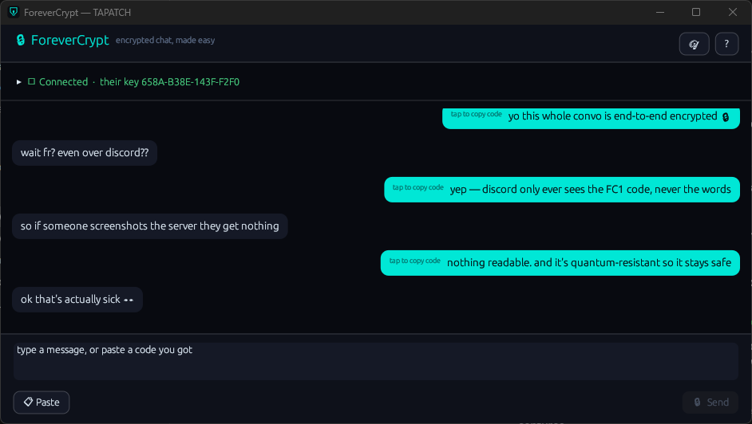
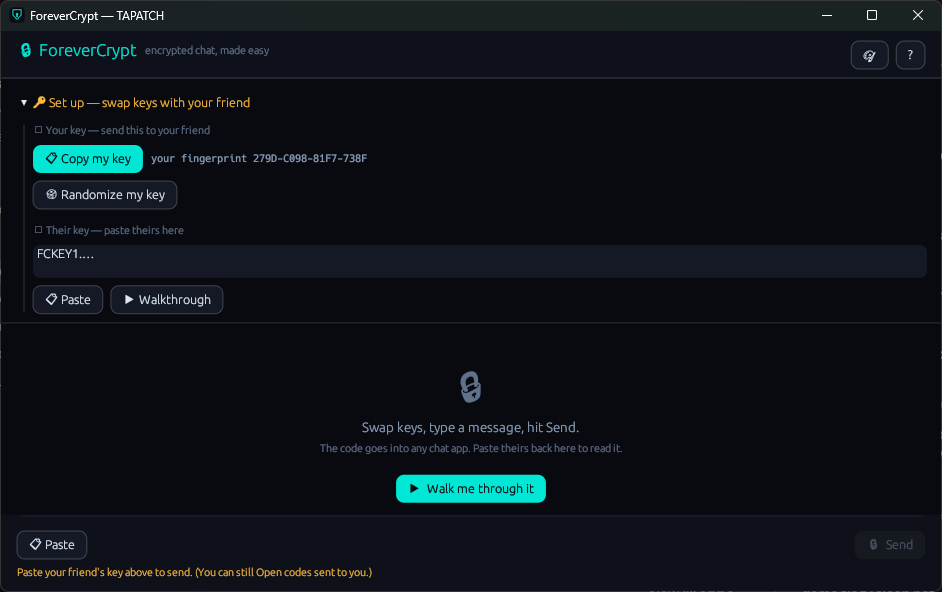
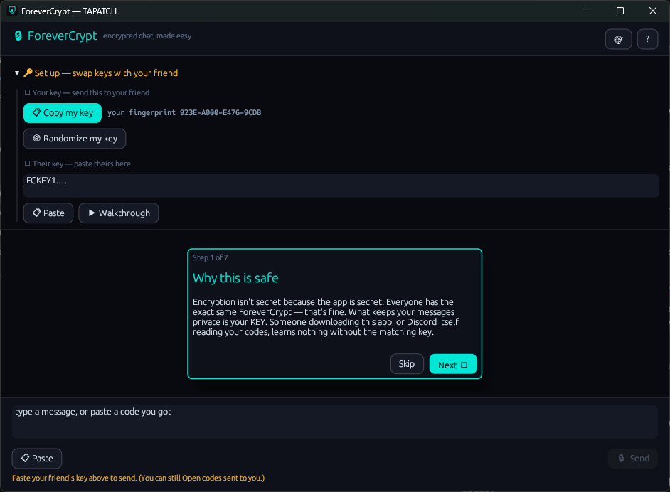
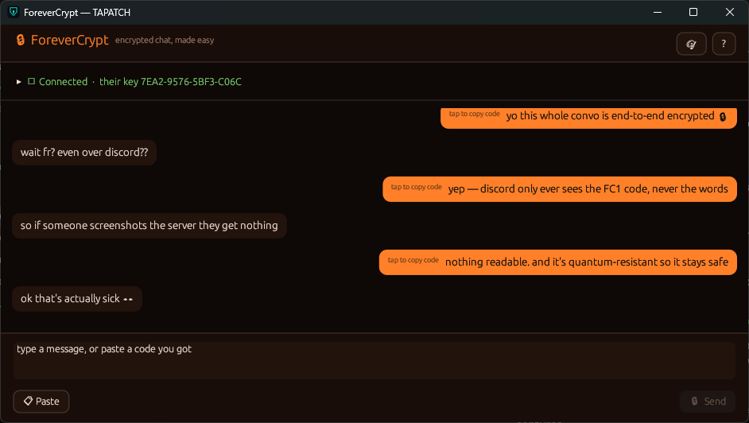

**ForeverCrypt 1.0.5** for Windows 10/11 (x64) · Free for personal use

### What's new

- The green dot when you're connected, the 1 and 2 step numbers and the arrows no longer show as empty boxes

### Screenshots

 
  

### Download

**`ForeverCrypt-Setup-1.0.5.exe`** is attached below. It is the same file as on [tapatch.com/tools/forevercrypt](https://tapatch.com/tools/forevercrypt/).

### Security

- VirusTotal: **2 / 70** engines flag it · [view report](https://www.virustotal.com/gui/file/887f4c6df6d308270ac69fb9d7f97732586898662082b07be12ef8724ca82db6/detection)
- SHA-256: `887f4c6df6d308270ac69fb9d7f97732586898662082b07be12ef8724ca82db6`

*First released on tapatch.com on 2026-11-07.*

---
Free for personal use. Business or commercial use requires a paid license (see [tapatch.com/terms](https://tapatch.com/terms/)).
